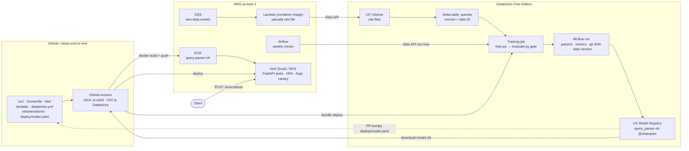

# mlops-end-to-end

A search query parser that tags each token as `author`, `category`, `format` or `other`.
The model is deliberately simple; the point is the MLOps around it. All data is fake.

## Architecture



**Lineage, read backwards from production:** pod → image tag `vN` → UC model version →
MLflow run → git SHA + Delta table version. Every link is recorded; none rely on memory.

### MLOps cycle

| Step | What happens | Where |
|---|---|---|
| 1. Data | Raw file → SQS → Lambda → UC Volume → Delta table (new version) | AWS → Databricks |
| 2. Train | Job reads a pinned Delta version; MLflow logs params, metrics, git SHA, data version | Databricks |
| 3. Gate | Golden-set F1 ≥ threshold **and** beats current `@champion` → register as `@challenger` | Databricks |
| 4. Promote | PR bumps `deploy/model.yaml`; human review + merge | GitHub |
| 5. Build | Actions pulls model vN, bakes it into the image, pushes `query-parser:vN` to ECR | GitHub Actions → AWS |
| 6. Deploy | Argo Rollouts canary (manual pause/promote) | kind / EKS |
| 7. Serve | FastAPI on the SageMaker contract (`/ping`, `/invocations`, port 8080); HPA on CPU | kind / EKS |
| 8. Retrain | Airflow weekly schedule triggers the training job → back to step 2 | Airflow → Databricks |

Monitoring is out of scope here; in production this would be Datadog (Argo Rollouts
Datadog provider for canary analysis, KEDA Datadog scaler for RPS-based scaling).

### Bootstrap vs steady state

The first run is manual: full backfill → Delta v0, train by hand, absolute gate only,
v1 set as `@champion` directly, direct rollout. Every later run is automated: incremental
data, scheduled retrain, relative gate against `@champion`, canary rollout, rollback to the
previous image.

## Quick start

```bash
uv sync          # base + dev deps
make test
make whoami      # fails unless AWS points at the personal account (needs direnv)
make data        # fake queries -> data/raw/queries.csv
```

## Layout

| Path | What | Status |
|---|---|---|
| `src/query_parser/` | generate_data, features, train, evaluate, app | in progress |
| `params.yaml` | settings for every pipeline stage | done |
| `data/`, `.dvc/` | DVC experiment: data versioned to S3 by content hash | done, kept as reference |
| `databricks.yml`, `resources/` | Databricks Asset Bundle: training job, dev/prod targets | planned |
| `lambda/` | SQS-triggered ingestion Lambda (SAM for local runs) | planned |
| `Dockerfile`, `deploy/model.yaml` | serving image + pinned model version | planned |
| `k8s/base`, `k8s/overlays/{kind,eks}` | Kustomize: Deployment, HPA, Argo Rollout | planned |
| `airflow/dags/` | weekly retrain DAG | planned |
| `infra/terraform/` | VPC, EKS, ECR, S3, SQS, Lambda, IAM (OIDC, IRSA), Karpenter | planned |
| `.github/workflows/` | CI now; bundle deploy, image build, EKS deploy later | in progress |

## Phases

1. Bootstrap in Databricks: Delta table, training, MLflow, UC registry, lineage
2. Serving locally: FastAPI image, kind, HPA, Argo Rollouts canary, k6 load test
3. Automation: SQS → Lambda ingestion, Airflow scheduled retrain with relative gate
4. AWS with Terraform: VPC (no NAT), EKS, ECR, IAM (IRSA), Karpenter on spot
5. GitHub Actions: OIDC to AWS, bundle deploy, build and push, promote via PR
6. Same image on a SageMaker endpoint, for comparison with EKS
